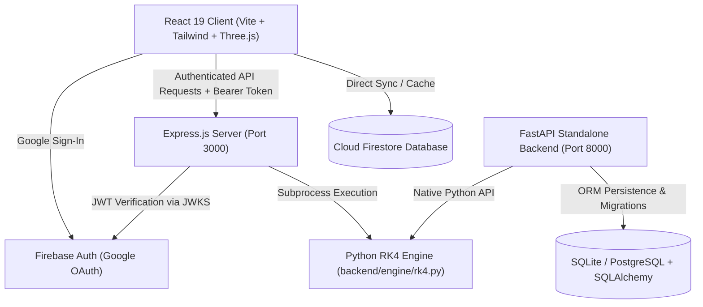

# 🚀 PROJECTILE LAB

[](LICENSE)
[](https://www.python.org/)
[](https://react.dev/)
[](https://threejs.org/)
[](https://fastapi.tiangolo.com/)
[](https://firebase.google.com/)

**Interactive Projectile Motion and Trajectory Prediction Platform Using the Classical Fourth-Order Runge-Kutta (RK4) Method.**

PROJECTILE LAB is a full-stack scientific simulation suite bridging mathematical precision with high-performance interactive 3D graphics. It models real-world ballistics, atmospheric aerodynamics, rocket propulsion, and aircraft flight dynamics with step-wise numerical inspection, convergence proofs, and comprehensive analytical error comparisons.

---

## 📑 Table of Contents

- [Key Features](#-key-features)
- [Mathematical & Numerical Formulation](#-mathematical--numerical-formulation)
  - [Fourth-Order Runge-Kutta (RK4)](#fourth-order-runge-kutta-rk4)
  - [Supported Physics Models](#supported-physics-models)
  - [Event Refinement & Convergence Proofs](#event-refinement--convergence-proofs)
- [System Architecture](#-system-architecture)
- [Project Structure](#-project-structure)
- [Quick Start & Local Development](#-quick-start--local-development)
  - [Prerequisites](#prerequisites)
  - [Installation & Launch](#installation--launch)
- [Docker Deployment](#-docker-deployment)
- [Testing & Quality Verification](#-testing--quality-verification)
- [Security & Authentication](#-security--authentication)
- [Contributing & License](#-contributing--license)

---

## ✨ Key Features

- **Precision Numerical Computing**:
  - Pure Python RK4 numerical solver (`backend/engine/rk4.py`) built directly from mathematical first principles without opaque ODE black-boxes.
  - Step-halving convergence analysis verifying $O(h^4)$ global convergence rates.
  - Sub-step ground-strike event refinement and 3-point parabolic apogee interpolation.
- **Interactive 3D Trajectory Visualization**:
  - Full Three.js 3D viewport (`src/components/SimulationCanvas3D.tsx`) with dynamic camera controls (Orbit, Chase, Top-Down, Launch Pad).
  - 6 procedural environments: *Earth Grasslands*, *Desert Canyon*, *Lunar Surface*, *Martian Basin*, *Open Ocean*, and *Cyber Neon Grid*.
  - Procedural projectile models: Classic Cannonball, Aerodynamic Rocket, Guided Missile, and Drone/Aircraft.
  - Trajectory trail ribbons, impact dust particle bursts, and landing accuracy indicators.
- **Comprehensive Scientific Analytics**:
  - 9 interactive Recharts graphs: Trajectory ($y$ vs $x$), Velocity Components ($v_x, v_y$ vs $t$), Speed ($|v|$ vs $t$), Accelerations, Kinetic/Potential Energy, and Error Residuals.
  - Instant one-click PNG chart export and raw simulation CSV data export.
  - Interactive RK4 Step Explorer dissecting intermediate derivative slopes ($k_1, k_2, k_3, k_4$) for any selected simulation point.
- **Audio & Accessibility**:
  - Dynamic Web Audio API synthesized sound engine (`src/lib/soundEngine.ts`) with realistic launch ignitions, aerodynamic wind whoosh, and ground impact rumble (no external audio assets required).
  - KaTeX mathematical equation rendering and dark/light adaptive UI theme.
- **Enterprise-Grade Persistence & Security**:
  - Google OAuth single sign-on via Firebase Authentication with backend JWT verification via `jose` against Google JWKS.
  - Dual persistence model: Cloud Firestore with hardened per-user security rules, alongside containerized SQLite / PostgreSQL via SQLAlchemy and Alembic.

---

## 🧮 Mathematical & Numerical Formulation

### Fourth-Order Runge-Kutta (RK4)

The state vector is defined as $\mathbf{Y}(t) = [x, y, v_x, v_y]^T$. The system of first-order differential equations is:

$$\frac{d\mathbf{Y}}{dt} = \mathbf{f}(t, \mathbf{Y}) = \begin{bmatrix} v_x \\ v_y \\ a_x(t, \mathbf{Y}) \\ a_y(t, \mathbf{Y}) \end{bmatrix}$$

For a discrete time step $h$:

$$\mathbf{k}_1 = \mathbf{f}(t_n, \mathbf{Y}_n)$$

$$\mathbf{k}_2 = \mathbf{f}\left(t_n + \frac{h}{2}, \mathbf{Y}_n + \frac{h}{2}\mathbf{k}_1\right)$$

$$\mathbf{k}_3 = \mathbf{f}\left(t_n + \frac{h}{2}, \mathbf{Y}_n + \frac{h}{2}\mathbf{k}_2\right)$$

$$\mathbf{k}_4 = \mathbf{f}(t_n + h, \mathbf{Y}_n + h\mathbf{k}_3)$$

$$\mathbf{Y}_{n+1} = \mathbf{Y}_n + \frac{h}{6} (\mathbf{k}_1 + 2\mathbf{k}_2 + 2\mathbf{k}_3 + \mathbf{k}_4)$$

### Supported Physics Models

1. **Model A: Ideal Ballistic Motion (`ideal`)**
   - Pure gravitational acceleration: $a_x = 0$, $a_y = -g$.
   - Validated against exact closed-form analytical solutions:
     $$R = \frac{v_0^2 \sin(2\theta)}{g}, \quad H = \frac{v_0^2 \sin^2(\theta)}{2g}, \quad T = \frac{2 v_0 \sin(\theta)}{g}$$
2. **Model B: Quadratic Air Resistance (`quadratic_drag`)**
   - Nonlinear velocity-squared drag: $\mathbf{F}_d = -\frac{1}{2} \rho C_d A \|\mathbf{v}\| \mathbf{v}$.
   - Accelerations:
     $$a_x = -\frac{\rho C_d A}{2m} v_x \sqrt{v_x^2 + v_y^2}$$
     $$a_y = -g - \frac{\rho C_d A}{2m} v_y \sqrt{v_x^2 + v_y^2}$$
3. **Model C: Powered Rocket Flight (`powered_rocket`)**
   - Active thrust vector aligned with velocity vector during burn duration $t \le t_{\text{burn}}$:
     $$\mathbf{F}_T = T_{\text{thrust}} \hat{\mathbf{v}}$$
   - Linearly decreasing propellant mass: $m(t) = m_0 - \dot{m} t$.
4. **Model D: 2D Aerodynamic Aircraft Flight (`aircraft_flight`)**
   - Aerodynamic lift perpendicular to velocity vector: $L = \frac{1}{2} \rho C_L A \|\mathbf{v}\|^2$.
   - Combined axial thrust, induced drag, and gravity vector.

### Event Refinement & Convergence Proofs

- **Linear Ground Impact Interpolation**: When $y_{n+1} < 0$, the exact landing timestamp and range are interpolated:
  $$t_{\text{land}} \approx t_n + h \frac{y_n}{y_n - y_{n+1}}, \quad x_{\text{land}} \approx x_n + v_{x,n}(t_{\text{land}} - t_n)$$
- **Parabolic Peak Interpolation**: Apogee coordinates are refined using a 3-point parabolic fit around the discrete maximum elevation.
- **Observed Convergence Order ($p$)**: Step-halving validation computes the empirical order:
  $$p = \log_2\left(\frac{\|E_h\|}{\|E_{h/2}\|}\right) \approx 4.0$$

---

## 🏗 System Architecture



---

## 📁 Project Structure

```text
PROJECTILE-LAB/
├── backend/
│   ├── alembic/                # Alembic database migrations
│   │   ├── versions/           # Initial schema version 0001
│   │   └── env.py
│   ├── app/                    # Standalone FastAPI service
│   │   ├── database.py         # SQLAlchemy engine & SQLite WAL config
│   │   ├── main.py             # REST endpoints (auth, simulations, steps)
│   │   └── models.py           # User, Simulation, Step ORM models
│   ├── engine/                 # Numerical simulation core
│   │   ├── cli.py              # Subprocess CLI runner & JSON encoder
│   │   └── rk4.py              # Pure 4th-order Runge-Kutta solver
│   ├── tests/                  # Backend unit tests
│   │   └── test_rk4.py         # Analytical & convergence tests
│   ├── alembic.ini             # Alembic migration configuration
│   ├── requirements.txt        # Python dependency manifest
│   └── .env.docker.example     # Docker environment template
├── public/                     # Static assets
├── src/
│   ├── components/             # React modular UI components
│   │   ├── ScientificCharts.tsx      # Recharts plotting suite
│   │   ├── SimulationCanvas3D.tsx    # Three.js 3D renderer
│   │   ├── Rk4IterationExplorer.tsx  # Intermediate k1-k4 inspector
│   │   ├── SimulationForm.tsx        # Parameter configuration controls
│   │   └── Navbar.tsx, Footer.tsx    # Layout components
│   ├── context/                # React state providers (Auth, Theme)
│   ├── lib/                    # Helper libraries
│   │   ├── firebase.ts         # Firebase client SDK initialization
│   │   └── soundEngine.ts      # Web Audio API sound synthesizer
│   ├── pages/                  # Page views (Home, History, Analytics, Learn)
│   ├── App.tsx                 # Root application component
│   └── main.tsx                # Entrypoint
├── docker-compose.yml          # Multi-container orchestration
├── Dockerfile                  # Production container definition
├── firestore.rules             # Cloud Firestore security rules
├── package.json                # Frontend dependencies & scripts
├── server.ts                   # Express server & Vite middleware
├── tsconfig.json               # TypeScript compiler config
└── vite.config.ts              # Vite bundler configuration
```

---

## ⚡ Quick Start & Local Development

### Prerequisites

- **Node.js**: v18.0.0 or higher (v20+ recommended)
- **Python**: v3.10 or higher
- **npm** or **bun**

### Installation & Launch

1. **Clone the repository**:
   ```bash
   git clone https://github.com/Akib358/Motion-Projectile.git
   cd Motion-Projectile
   ```

2. **Configure environment variables**:
   ```bash
   cp .env.example .env
   ```

3. **Install dependencies**:
   ```bash
   npm install
   ```

4. **Start the development server**:
   ```bash
   npm run dev
   ```

5. **Open in your browser**:
   Navigate to `http://localhost:3000`. Sign in with your Google account to run simulations, view 3D animations, inspect step calculations, and save history.

---

## 🐳 Docker Deployment

To launch the full containerized environment with FastAPI, SQLite persistence, and production Vite frontend:

```bash
docker compose up --build -d
```

- **Frontend Application**: `http://localhost:3000`
- **FastAPI Documentation & Swagger UI**: `http://localhost:8000/docs`
- **Health Check**: `http://localhost:8000/api/health`

Persistent SQLite storage is mounted to the named volume `sqlite_data` at `/data/projectile_lab.db`.

---

## 🧪 Testing & Quality Verification

Run the Python numerical validation suite (analytical accuracy, step halving, convergence order, rocket thrust, and aerodynamic lift):

```bash
python -m unittest discover -s backend/tests -v
```

Expected output:
```text
test_aircraft_lift_extends_flight ... ok
test_destination_not_silently_forced ... ok
test_ideal_projectile_matches_analytical ... ok
test_input_validation_rejects_invalid_angle_and_negative_velocity ... ok
test_powered_rocket_increases_range_over_ballistic ... ok
test_quadratic_drag_reduces_range_and_height ... ok
test_rk4_stores_derivative_stages_k1_to_k4 ... ok
test_step_halving_convergence_fourth_order_on_drag ... ok

Ran 8 tests in 0.03s - OK
```

To run frontend tests and production build verification:
```bash
npm test
npm run build
```

---

## 🔒 Security & Authentication

- **Zero-Secret Commits**: All production keys and service secrets are safely isolated in environment variables.
- **Identity Isolation**: Backend endpoints enforce Firebase JWT authentication verified against Google JWKS public certificates.
- **Firestore Guard**: Firestore security rules restrict all document access to `request.auth.uid == userId`, preventing unauthorized read, write, or cross-tenant query operations.

---

## 📄 License

This project is licensed under the [MIT License](LICENSE).
